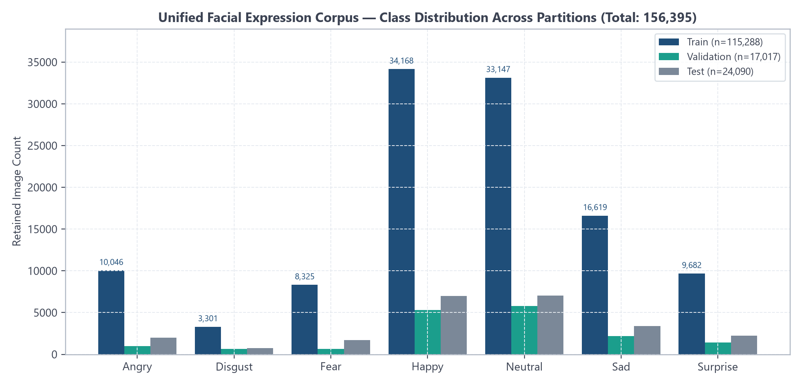

# Data Card — Unified Facial Expression Corpus (Kexia V4B)

## Dataset Summary

| Attribute | Value |
|---|---|
| **Corpus Name** | Unified Local Facial Expression Corpus (`Kexia V4B`) |
| **Total Scanned Files** | `163,567` |
| **Successfully Decoded RGB Images** | `163,567` (`0` decoding errors in `scan_issues.csv`) |
| **Excluded Images (Exact Dedup & Conflicts)** | `7,172` |
| **Retained Audited Corpus Size** | `156,395` |
| **Partitions** | `train` (`115,288` / 73.72%), `validation` (`17,017` / 10.88%), `test` (`24,090` / 15.40%) |
| **Expression Classes (`0..6`)** | `angry`, `disgust`, `fear`, `happy`, `neutral`, `sad`, `surprise` |
| **Public Repository Policy** | **Zero facial images and zero file paths are included in the repository.** Only aggregate distribution tables and sanitized audit summaries are published. |

---

## Class and Partition Distribution

The retained corpus exhibits pronounced class imbalance. `happy` and `neutral` together represent **58.41%** of the training partition and **65.11%** of the validation partition, whereas `disgust` accounts for only **2.86%** of training and **3.83%** of validation.

| Class ID | Expression | Train | Validation | Test | Total per Class | Share of Total | Train Loss Weight |
|---:|---|---:|---:|---:|---:|---:|---:|
| `0` | `angry` | 10,046 | 1,002 | 1,975 | 13,023 | 8.33% | `1.364` |
| `1` | `disgust` | 3,301 | 651 | 756 | 4,708 | 3.01% | `2.380` |
| `2` | `fear` | 8,325 | 647 | 1,688 | 10,660 | 6.82% | `1.499` |
| `3` | `happy` | 34,168 | 5,308 | 6,973 | 46,449 | 29.70% | `0.740` |
| `4` | `neutral` | 33,147 | 5,772 | 7,052 | 45,971 | 29.39% | `0.751` |
| `5` | `sad` | 16,619 | 2,208 | 3,402 | 22,229 | 14.21% | `1.061` |
| `6` | `surprise` | 9,682 | 1,429 | 2,244 | 13,355 | 8.54% | `1.390` |
| — | **Total** | **115,288** | **17,017** | **24,090** | **156,395** | **100.00%** | — |

---

## Integrity Audit and Deduplication Protocol

Before training, every image file under the unified directory hierarchy was audited through a deterministic three-hash pipeline implemented in `src/preprocessing.py`:

1. **EXIF Normalization & RGB Conversion:** Each file is opened with Pillow, transposed according to EXIF orientation tags (`ImageOps.exif_transpose`), and converted to 3-channel `RGB`.
2. **Cryptographic File & Pixel Hashing:**
   - `file_hash`: SHA-256 of the raw file bytes on disk.
   - `pixel_hash`: SHA-256 of the decoded RGB array shape and raw pixel buffer (`str(a.shape).encode() + a.tobytes()`), invariant to container format or metadata differences.
3. **Conflicting-Label Removal:** Any `pixel_hash` associated with more than one class label across the entire scanned corpus (`158` distinct conflicting pixel hashes) had **all** of its instances removed to prevent contradictory supervision.
4. **Cross-Split Priority Deduplication:** Among remaining exact `pixel_hash` duplicates (`1,556` pixel hashes appeared in more than one split), exactly one instance was retained using the strict priority order:

$$
\mathrm{priority}(\texttt{test}) = 0 < \mathrm{priority}(\texttt{validation}) = 1 < \mathrm{priority}(\texttt{train}) = 2
$$

   This ensures that if an exact decoded image existed in both `test` (or `validation`) and `train`, it was kept in the evaluation split and removed from `train`.

### Summary of Audit Metrics (`artifacts/reports/dataset_audit.json`)

| Audit Metric | Count | Description |
|---|---:|---|
| `scanned` | `163,567` | Total candidate image files discovered across partitions |
| `decoded` | `163,567` | Images decoded without error (`issues = 0`) |
| `conflicting_hashes` | `158` | Unique `pixel_hash` digests mapped to $\ge 2$ distinct expression classes |
| `cross_split_hashes` | `1,556` | Unique `pixel_hash` digests appearing across multiple partitions prior to deduplication |
| `excluded` | `7,172` | Total image files excluded (`exact_duplicate` or `conflicting_label`) |
| `retained` | `156,395` | Final deduplicated corpus with unique `pixel_hash` across all partitions |

Sanitized per-split and per-class exclusion counts (with all local file paths stripped) are provided in [`artifacts/reports/excluded_images_summary.csv`](artifacts/reports/excluded_images_summary.csv) and [`artifacts/reports/audit_summary_breakdown.json`](artifacts/reports/audit_summary_breakdown.json).

---

## Perceptual-Hash (dHash) Audit and Residual Leakage Risks

In addition to exact pixel deduplication, a 64-bit horizontal difference hash (`dhash`) was computed by resizing each grayscale image to $9 \times 8$ via Lanczos interpolation and packing horizontal luminance gradients (`g[:, 1:] > g[:, :-1]`).

- **Cross-Partition dHash Candidates:** Across the 156,395 retained images, **4,865** images share an identical 64-bit `dhash` with at least one image in another partition (recorded in aggregate form in [`artifacts/reports/perceptual_candidates_summary.csv`](artifacts/reports/perceptual_candidates_summary.csv)).
- **Interpretation:** Identical 64-bit dHashes across distinct `pixel_hash` values indicate either near-duplicate images (e.g., recompressed, slightly cropped, or contrast-adjusted versions of the same photograph) or low-entropy/low-resolution crops ($48 \times 48$ grayscale-derived faces) that collapse to the same coarse $9 \times 8$ gradient signature.
- **No Subject Identity Metadata:** The unified directory layout (`data/<split>/<class>/<filename>`) merges multiple legacy facial expression sources without per-subject identity labels or per-image dataset provenance records. Consequently, exact pixel deduplication does not guarantee subject-disjoint partitions.

---

## Privacy, Provenance, and Redistribution Restrictions

1. **Biometric & Facial Privacy:** Facial images depict human subjects. No images from `data/`, serialized dataset archives (`dataset_train_procesado.pkl`), or CSV manifests containing file names and local paths (`manifest.csv`, `excluded_images.csv`, `perceptual_candidates.csv`, `validation_predictions.csv`) are included in this repository.
2. **Provenance Verification Required:** Because the unified folder combines images from heterogeneous sources without explicit per-image license metadata, neither the dataset nor weights trained on it should be publicly redistributed until upstream dataset licenses and terms of use are verified.
