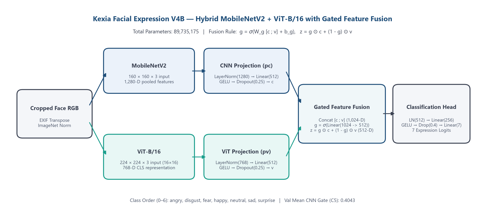
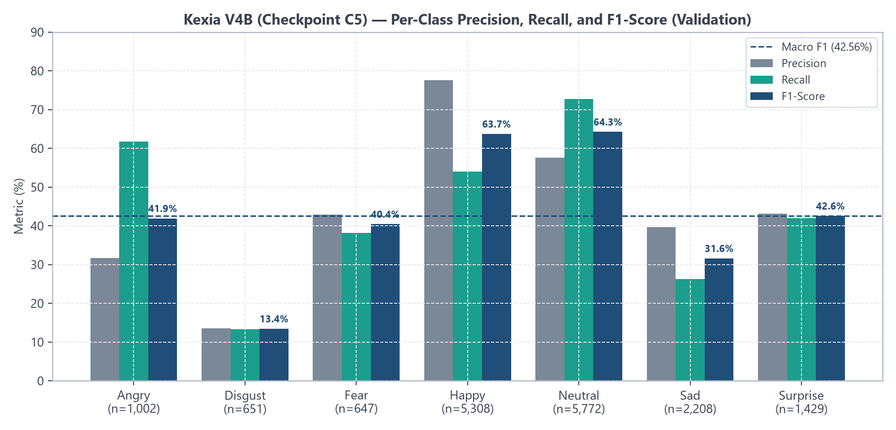

# Model Card — Kexia Facial Expression V4B

## Model Details

| Field | Specification |
|---|---|
| **Model Name** | Kexia Facial Expression V4B (`HybridFER`) |
| **Version / Run ID** | `V4B` / `20261124_102050_038611` |
| **Architecture Type** | Hybrid Convolutional–Transformer with Learnable Gated Feature Fusion |
| **Backbones** | `torchvision.models.mobilenet_v2` (160 × 160 RGB) + `torchvision.models.vit_b_16` (224 × 224 RGB) |
| **Total Parameters** | `89,735,175` |
| **Task** | Seven-class visual facial expression classification on cropped facial images |
| **Class Order (`0..6`)** | `angry`, `disgust`, `fear`, `happy`, `neutral`, `sad`, `surprise` |
| **Primary Selection Metric** | Validation Macro F1 |
| **Selected Checkpoint** | `best.pt` (Stage **C**, Epoch **5**, Validation Macro F1 = **42.56%**) |
| **Recovered Checkpoint** | `best_original.pt` (Stage **B**, Epoch **5**, Validation Macro F1 = **40.68%**) |
| **Final Epoch Checkpoint** | `last.pt` (Stage **C**, Epoch **12**, Validation Macro F1 = **41.75%**, Early Stopping) |
| **Development Environment** | PyTorch 2.8.0+cu128, torchvision 0.23.0, CUDA 12.8, NVIDIA GeForce RTX 5070 Ti Laptop GPU (11.94 GiB VRAM) |
| **License Status** | **Pending verification.** No public license is granted until code, dataset provenance, and pretrained weight redistribution terms are formally audited. |

---

## Intended Use and Scope

### Primary Intended Use
- **Academic and Experimental Research:** Investigating dual-branch representation fusion (local convolutional inductive biases from MobileNetV2 combined with global self-attention tokens from ViT-B/16), progressive multi-stage unfreezing schedules, and the impact of severe class imbalance on Macro F1 and generalization gaps.
- **Reproducible Benchmarking:** Evaluating visual expression classification on pre-cropped facial images under controlled preprocessing and deduplication rules.

### Out-of-Scope and Prohibited Uses
- **Not a Psychological or Clinical Instrument:** This model classifies visual patterns according to categorical dataset annotations. Softmax outputs are uncalibrated algebraic scores over the seven training labels and **do not** measure internal, subjective, psychological, or clinical emotional states.
- **Not Validated for Production or High-Stakes Decisions:** The model must not be deployed in surveillance, law enforcement, border control, employment screening, credit scoring, education assessment, healthcare, or automated decision-making affecting individuals.
- **No Integrated Face Detection:** The model expects a single, tightly cropped face image. The repository banner (`assets/banner.png`) is a conceptual illustration and does not depict an integrated face detector or landmark tracker.

---

## Mathematical Architecture

Given an input RGB facial crop $I$, two deterministic rescalings with ImageNet normalization ($\mu = (0.485, 0.456, 0.406)$, $\sigma = (0.229, 0.224, 0.225)$) are produced:
- $x \in \mathbb{R}^{3 \times 160 \times 160}$ fed to MobileNetV2 (`classifier` replaced by `Identity`), yielding $f_{\mathrm{cnn}}(x) \in \mathbb{R}^{1280}$.
- $y \in \mathbb{R}^{3 \times 224 \times 224}$ fed to ViT-B/16 (`heads` replaced by `Identity`), yielding $f_{\mathrm{vit}}(y) \in \mathbb{R}^{768}$.

Each branch is projected into a shared 512-dimensional embedding space via branch-specific projection modules (`pc` and `pv`):

$$
c = \mathrm{Dropout}_{0.25}\!\left(\mathrm{GELU}\!\left(W_c\,\mathrm{LN}(f_{\mathrm{cnn}}(x)) + b_c\right)\right) \in \mathbb{R}^{512}
$$

$$
v = \mathrm{Dropout}_{0.25}\!\left(\mathrm{GELU}\!\left(W_v\,\mathrm{LN}(f_{\mathrm{vit}}(y)) + b_v\right)\right) \in \mathbb{R}^{512}
$$

The **Gated Feature Fusion** module computes a dimension-wise gate $g \in (0, 1)^{512}$ from the concatenated representation $[c ; v] \in \mathbb{R}^{1024}$:

$$
g = \sigma\!\left(W_g [c ; v] + b_g\right), \qquad z = g \odot c + (1 - g) \odot v \in \mathbb{R}^{512}
$$

Finally, the classification head maps $z$ to seven expression logits:

$$
\hat{\ell} = W_2\,\mathrm{Dropout}_{0.4}\!\left(\mathrm{GELU}\!\left(W_1\,\mathrm{LN}(z) + b_1\right)\right) + b_2 \in \mathbb{R}^{7}
$$

---

## Training Procedure & Progressive Fine-Tuning

The model was trained with square-root inverse class frequency weights normalized by the empirical training distribution:
- `angry`: `1.364`, `disgust`: `2.380`, `fear`: `1.499`, `happy`: `0.740`, `neutral`: `0.751`, `sad`: `1.061`, `surprise`: `1.390`.
- Optimizer: `AdamW` ($\text{weight decay} = 0.01$), gradient clipping ($\|\nabla\|_2 \le 1.0$), physical batch size $8$, gradient accumulation $4$ (effective batch size $32$), mixed precision (`bfloat16`/`float16`), and cosine annealing schedule with 5% linear warmup.

| Stage | Unfrozen Modules | Max Epochs | Patience | Head LR | CNN LR | ViT LR |
|---|---|---:|---:|---:|---:|---:|
| **Stage A** | Projections (`pc`, `pv`), `gate`, `head` (backbones frozen) | 8 | 4 | `1e-3` | `0` | `0` |
| **Stage B** | Stage A + last 4 MobileNetV2 blocks + last 2 ViT encoder blocks & `encoder.ln` | 20 | 6 | `1e-4` | `3e-5` | `1e-5` |
| **Stage C** | Stage A + last 8 MobileNetV2 blocks + last 4 ViT encoder blocks & `encoder.ln` | 25 | 7 | `5e-5` | `1e-5` | `5e-6` |

*Note on Batch Normalization:* All `BatchNorm2d` layers in MobileNetV2 remain frozen in evaluation mode across Stages A, B, and C to preserve running statistics under small physical batch size ($B=8$).

*Note on Training Resumption:* The initial execution (`metrics_history.csv`) ran through Stage A (A1–A8) and Stage B up to B8, where it was interrupted. Because the original loop saved only `best.pt` (which at that time corresponded to **B5**, Macro F1 = 0.4068, backed up as `best_original.pt`) without optimizer state, training was resumed from **B5** (B6–B19, followed by Stage C1–C12, recorded in `metrics_resumed.csv`) using a freshly initialized `AdamW` optimizer and an approximated cosine scheduler step ($s_0 = \text{steps\_per\_epoch} \times 5$). Subsequent epochs saved full recovery state in `last.pt`.

---

## Evaluation Results (Validation Set, $N = 17,017$)

### Aggregate Metrics Across Checkpoints

| Metric | Recovered B5 (`best_original.pt`) | Selected C5 (`best.pt`) | Final Epoch C12 (`last.pt`) |
|---|---:|---:|---:|
| **Validation Macro F1** (selection metric) | 40.68% (`0.4068`) | **42.56%** (`0.4256`) | 41.75% (`0.4175`) |
| **Validation Accuracy** | 53.24% (`0.5324`) | **54.06%** (`0.5406`) | 51.35% (`0.5135`) |
| **Validation Balanced Accuracy** | 40.52% (`0.4052`) | **44.05%** (`0.4405`) | 43.86% (`0.4386`) |
| **Validation Weighted F1** | 51.94% (`0.5194`) | **53.86%** (`0.5386`) | 51.87% (`0.5187`) |
| **Validation Cross-Entropy Loss** | `1.3109` | `1.4110` | `1.6556` |
| **Training Accuracy** | 66.25% (`0.6625`) | 73.25% (`0.7325`) | 77.34% (`0.7734`) |
| **Training Loss** | `1.0249` | `0.7947` | `0.6613` |
| **Mean CNN Gate Activation ($\bar{g}$)** | `0.4046` | `0.4043` | — |

### Per-Class Validation Breakdown (Selected Checkpoint C5, `best.pt`)

| Class ID | Expression | Precision | Recall | F1-Score | Support |
|---:|---|---:|---:|---:|---:|
| `0` | `angry` | 31.73% (`0.3173`) | 61.78% (`0.6178`) | 41.92% (`0.4192`) | 1,002 |
| `1` | `disgust` | 13.51% (`0.1351`) | 13.36% (`0.1336`) | 13.44% (`0.1344`) | 651 |
| `2` | `fear` | 42.96% (`0.4296`) | 38.18% (`0.3818`) | 40.43% (`0.4043`) | 647 |
| `3` | `happy` | 77.62% (`0.7762`) | 54.03% (`0.5403`) | 63.71% (`0.6371`) | 5,308 |
| `4` | `neutral` | 57.54% (`0.5754`) | 72.75% (`0.7275`) | 64.25% (`0.6425`) | 5,772 |
| `5` | `sad` | 39.64% (`0.3964`) | 26.27% (`0.2627`) | 31.60% (`0.3160`) | 2,208 |
| `6` | `surprise` | 43.13% (`0.4313`) | 41.99% (`0.4199`) | 42.55% (`0.4255`) | 1,429 |
| — | **Macro Average** | **43.73%** (`0.4373`) | **44.05%** (`0.4405`) | **42.56%** (`0.4256`) | **17,017** |
| — | **Weighted Average** | **56.51%** (`0.5651`) | **54.06%** (`0.5406`) | **53.86%** (`0.5386`) | **17,017** |

### Independent Test Set Status
- **Status:** **Pending Execution.**
- The held-out test partition contains **24,090** audited images. In the final notebook, evaluation cell execution was interrupted early during the validation pass (`4% | 87/2128`), so no `test_metrics.json`, `test_classification_report.csv`, or `test_confusion_matrix.csv` files exist for checkpoint C5. No test claims are made.

---

## Limitations, Risks, and Distribution Policy

1. **Overfitting and Generalization Gap:** At the selected checkpoint C5, training accuracy is 73.25% vs. 54.06% validation accuracy (a 19.19 percentage-point gap). By C12, the gap widens to 25.99 percentage points (`77.34%` vs. `51.35%`) while validation cross-entropy rises to `1.6556`.
2. **Severe Minority-Class Weakness:** `disgust` achieves an F1-score of only 13.44% (`87 / 651` true positives, with `308 / 651` misclassified as `neutral` and `120 / 651` as `angry`), and `sad` achieves 31.60% F1 (`814 / 2,208` predicted as `neutral`).
3. **Unresolved Perceptual & Identity Overlap:** While exact decoded pixel duplicates were removed, 4,865 cross-partition perceptual dHash candidates remain, and subject identity annotations are unavailable.
4. **Weight Redistribution Policy:** Model checkpoint files (`best.pt`, `best_original.pt`, `last.pt`, ~343–1,030 MB each) remain in the private workspace and are excluded via `.gitignore`. If future distribution is authorized after dataset license verification, weights should be hosted via **Git LFS**, **GitHub Releases**, or **Hugging Face Hub** rather than committed directly to Git history.
