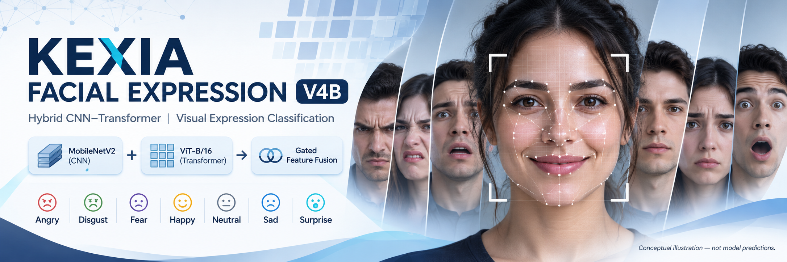
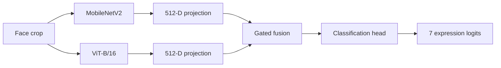

  

# Kexia Facial Expression V4B

**Hybrid convolutional–transformer architecture for visual facial expression classification**

## Overview

Kexia Facial Expression V4B investigates adaptive fusion of convolutional and transformer representations for seven-class facial expression classification. It combines MobileNetV2 and ViT-B/16 through a trainable feature gate, with progressive fine-tuning and checkpoint-based model selection.

The objective is to study representation fusion, class imbalance and generalization, not to infer a person's internal emotional state. This is an experimental research prototype, not a production-ready or clinically validated system.

## Architecture

| Component | Specification |
|---|---|
| CNN backbone | MobileNetV2, 160 × 160 RGB input |
| Transformer backbone | ViT-B/16, 224 × 224 RGB input |
| Backbone feature dimensions | 1,280 and 768 |
| Feature projections | 512 dimensions per branch |
| Fusion | Learnable sigmoid gate |
| Classification head | 512 → 256 → 7 |
| Total parameters | 89,735,175 |

Let $c$ and $v$ denote the projected CNN and transformer embeddings. Their fusion is defined by

$$
g=\sigma(W_g[c;v]+b_g), \qquad
z=g\odot c+(1-g)\odot v.
$$

The classification head maps the fused representation to seven logits. Softmax produces a distribution over the dataset's expression labels, not a calibrated measure of emotional state.

The class order is `angry`, `disgust`, `fear`, `happy`, `neutral`, `sad`, `surprise`.

## Dataset and integrity

The unified local corpus contains 156,395 retained images across three partitions.

| Expression | Train | Validation | Test |
|---|---:|---:|---:|
| Angry | 10,046 | 1,002 | 1,975 |
| Disgust | 3,301 | 651 | 756 |
| Fear | 8,325 | 647 | 1,688 |
| Happy | 34,168 | 5,308 | 6,973 |
| Neutral | 33,147 | 5,772 | 7,052 |
| Sad | 16,619 | 2,208 | 3,402 |
| Surprise | 9,682 | 1,429 | 2,244 |
| **Total** | **115,288** | **17,017** | **24,090** |

The pipeline audits exact duplicates, conflicting labels and cross-partition overlap. The notebook reports 4,865 cross-partition perceptual-hash candidates requiring further review. Exact deduplication does not establish identity-level independence or eliminate all leakage.

The corpus is imbalanced, and original per-image dataset provenance is not available in the unified folder structure. Redistribution rights must be verified before distributing images or weights. Facial images are not intended for inclusion in the public repository.

## Training methodology

The experiment uses transfer learning, weighted cross-entropy, AdamW, cosine learning-rate decay with warmup, gradient accumulation (batch size 8, accumulation 4), gradient clipping and mixed precision on an NVIDIA GeForce RTX 5070 Ti Laptop GPU (PyTorch 2.8.0, CUDA 12.8).

- **Stage A:** train projection, fusion and classification layers with frozen backbones.
- **Stage B:** partially unfreeze the CNN and transformer.
- **Stage C:** unfreeze additional backbone blocks; batch normalization remains frozen.

The experiment was interrupted during stage B. Training resumed from B5 with a newly initialized optimizer and an approximate scheduler position. Subsequent checkpoints preserve optimizer, scheduler and scaler states at epoch boundaries. This is not an exact deterministic continuation of the original run.

## Experimental results

The selected checkpoint is **C5**, chosen by validation Macro F1. Training stopped at C12 through early stopping.

| Metric | Recovered B5 | Selected C5 |
|---|---:|---:|
| Validation accuracy | 53.24% | 54.06% |
| Validation Macro F1 | 40.68% | 42.56% |
| Validation balanced accuracy | — | 44.05% |
| Validation weighted F1 | — | 53.86% |
| Training accuracy | — | 73.25% |
| Validation cross-entropy | — | 1.4110 |

Macro F1 improved by approximately 1.88 percentage points after resumption. At C12, training accuracy reached 77.34%, while validation accuracy was 51.35%, a gap of 25.99 percentage points. Validation loss rose to 1.6556. This behavior is consistent with overfitting.

Macro F1 is the primary selection metric because it gives each expression class equal weight:

$$
F_{1,\mathrm{macro}}=\frac{1}{7}\sum_{k=1}^{7}
\frac{2P_kR_k}{P_k+R_k}.
$$

**Independent test status:** the supplied final notebook enables test evaluation, but its saved output does not contain completed test metrics. The 24,090-image test partition must be evaluated and its results verified before any test-performance claim is made.

## Limitations and responsible use

- Moderate validation performance and a substantial train–validation gap.
- Unequal class frequencies and potential label ambiguity across sources.
- Unresolved perceptual duplicates and possible shared identities across partitions.
- No demonstrated superiority of gated fusion over individual backbones.
- No verified external-domain performance, probability calibration or subgroup robustness.
- The model expects a cropped face; the cover illustration does not demonstrate a face detector or landmark module.
- Not intended for psychological assessment, clinical diagnosis, surveillance, hiring, or decisions about individuals.

## Research roadmap

| Priority | Experiment | Evaluation criterion |
|---|---|---|
| 1 | Audit ambiguous labels, perceptual duplicates and identity overlap | Documented corrections and leakage checks |
| 2 | Reassess minority-class sampling and weighted or focal loss | Macro F1, per-class precision and recall |
| 3 | Compare CNN-only, ViT-only, concatenation and gated fusion on the same manifest | Macro F1, parameter count, inference latency |
| 4 | Evaluate stronger regularization and smaller fine-tuning learning rates | Validation loss and generalization gap |
| 5 | Evaluate facial alignment and consistent preprocessing | Controlled preprocessing ablation |
| 6 | Calibrate probabilities and evaluate external-domain robustness | ECE, Brier score, independent test metrics |

All experiments should preserve fixed evaluation partitions, report uncertainty across repeated runs where feasible, and avoid tuning against the test set.

## Reproducibility

The experiment is implemented in a Jupyter notebook with PyTorch and torchvision. The public release should contain sanitized source code, the class mapping, preprocessing configuration and verified aggregate metrics. The original local dataset and private paths should not be published. Trained weights should only be distributed after a license and provenance review.

## References

- Sandler et al. (2018). *MobileNetV2: Inverted Residuals and Linear Bottlenecks*. [arXiv:1801.04381](https://arxiv.org/abs/1801.04381).
- Dosovitskiy et al. (2021). *An Image Is Worth 16×16 Words: Transformers for Image Recognition at Scale*. [arXiv:2010.11929](https://arxiv.org/abs/2010.11929).
- Lin et al. (2017). *Focal Loss for Dense Object Detection*. [arXiv:1708.02002](https://arxiv.org/abs/1708.02002).
- Loshchilov and Hutter (2019). *Decoupled Weight Decay Regularization*. [arXiv:1711.05101](https://arxiv.org/abs/1711.05101).

---

**Kexia — Experimental computer vision research.**  
Results are reported transparently; further validation is required. Licensing and redistribution terms remain to be established.
