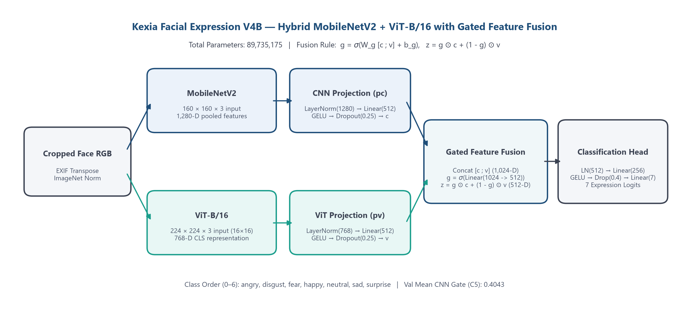

# Mathematical and Computational Architecture — Kexia Facial Expression V4B

## 1. Design Rationale

Facial expression analysis in unconstrained images requires capturing both fine-grained local deformations (e.g., nasolabial furrows, eyebrow corrugation, lip corner pull, eye aperture) and holistic spatial relationships across the entire face. **Kexia Facial Expression V4B (`HybridFER`)** combines two complementary inductive biases:

1. **Local Convolutional Stream (`MobileNetV2`):** Depthwise separable convolutions and inverted residual blocks with linear bottlenecks extract translation-equivariant local textures at a compact $160 \times 160$ input resolution.
2. **Global Self-Attention Stream (`ViT-B/16`):** Non-overlapping $16 \times 16$ patch tokens over a $224 \times 224$ input resolution ($14 \times 14 = 196$ spatial tokens plus 1 `[CLS]` token) model long-range inter-region dependencies across 12 Transformer encoder layers.
3. **Learnable Gated Feature Fusion:** Rather than static concatenation, a content-dependent sigmoid gate $g \in (0, 1)^{512}$ weights each dimension of the projected CNN and Transformer embeddings for every input image.

---

## 2. Formal Mathematical Specification

### 2.1 Dual-Resolution Input Normalization

Let $I \in \{0, \dots, 255\}^{H \times W \times 3}$ be an EXIF-normalized RGB facial crop. Two deterministic bilinear-antialiased resize transformations followed by channel-wise ImageNet standardization ($\mu = (0.485, 0.456, 0.406)^\top$, $\sigma = (0.229, 0.224, 0.225)^\top$) produce the dual inputs:

$$
x = \frac{\mathrm{Resize}_{160 \times 160}(I) / 255 - \mu}{\sigma} \in \mathbb{R}^{3 \times 160 \times 160}, \qquad
y = \frac{\mathrm{Resize}_{224 \times 224}(I) / 255 - \mu}{\sigma} \in \mathbb{R}^{3 \times 224 \times 224}
$$

### 2.2 Backbone Feature Extraction

- **MobileNetV2 Backbone (`self.cnn`):** With `self.cnn.classifier = nn.Identity()`, global average pooling over the final $1280 \times 5 \times 5$ feature map produces:

$$
h_c = f_{\mathrm{cnn}}(x) \in \mathbb{R}^{1280}
$$

- **ViT-B/16 Backbone (`self.vit`):** With `self.vit.heads = nn.Identity()`, the final LayerNorm output of the `[CLS]` token after 12 multi-head self-attention blocks ($H=12$ heads, $d_{\mathrm{model}}=768$, MLP dimension $3072$) produces:

$$
h_v = f_{\mathrm{vit}}(y) \in \mathbb{R}^{768}
$$

### 2.3 Branch Projection Modules (`self.pc` and `self.pv`)

To align dimensionality and feature scale prior to fusion, each backbone representation is normalized and projected to $\mathbb{R}^{512}$:

$$
c = \mathrm{Dropout}_{0.25}\!\left(\mathrm{GELU}\!\left(W_{\mathrm{pc}}\,\mathrm{LayerNorm}_{1280}(h_c) + b_{\mathrm{pc}}\right)\right) \in \mathbb{R}^{512}
$$

$$
v = \mathrm{Dropout}_{0.25}\!\left(\mathrm{GELU}\!\left(W_{\mathrm{pv}}\,\mathrm{LayerNorm}_{768}(h_v) + b_{\mathrm{pv}}\right)\right) \in \mathbb{R}^{512}
$$

where $W_{\mathrm{pc}} \in \mathbb{R}^{512 \times 1280}$ and $W_{\mathrm{pv}} \in \mathbb{R}^{512 \times 768}$.

### 2.4 Gated Feature Fusion (`self.gate`)

Let $u = [c ; v] \in \mathbb{R}^{1024}$ denote the concatenation of both 512-dimensional embeddings. The gating network computes an element-wise convex combination coefficient vector $g \in (0, 1)^{512}$:

$$
g = \sigma\!\left(W_g [c ; v] + b_g\right), \qquad W_g \in \mathbb{R}^{512 \times 1024}, \; b_g \in \mathbb{R}^{512}
$$

$$
z = g \odot c + (\mathbf{1}_{512} - g) \odot v \in \mathbb{R}^{512}
$$

where $\sigma(t) = (1 + e^{-t})^{-1}$ is the logistic sigmoid and $\odot$ denotes the Hadamard (element-wise) product.
- For each sample $i$, the scalar diagnostic $\bar{g}_i = \frac{1}{512}\sum_{d=1}^{512} g_{i,d}$ quantifies the average contribution assigned to the MobileNetV2 branch relative to the ViT-B/16 branch. Across the 17,017 validation images at checkpoint C5, $\bar{g} = 0.4043$ (approximately 40.4% CNN weight and 59.6% ViT weight).

### 2.5 Classification Head (`self.head`)

The fused representation $z \in \mathbb{R}^{512}$ is mapped to seven class logits $\hat{\ell} \in \mathbb{R}^{7}$:

$$
h_{\mathrm{head}} = \mathrm{Dropout}_{0.40}\!\left(\mathrm{GELU}\!\left(W_1\,\mathrm{LayerNorm}_{512}(z) + b_1\right)\right) \in \mathbb{R}^{256}
$$

$$
\hat{\ell} = W_2 h_{\mathrm{head}} + b_2 \in \mathbb{R}^{7}, \qquad p_k = \frac{\exp(\hat{\ell}_k)}{\sum_{j=1}^{7} \exp(\hat{\ell}_j)}
$$

---

## 3. Parameter Inventory and Stage Trainability

The complete `HybridFER(mode='hybrid', fusion='gated')` module contains exactly **89,735,175** parameters:

| Submodule | Layer Composition | Parameter Count | Stage A Trainable | Stage B Trainable | Stage C Trainable |
|---|---|---:|---:|---:|---:|
| `cnn` (`MobileNetV2`) | 19 `features` blocks (`BatchNorm2d` always frozen) | `2,223,872` | `0` | `1,659,520` (last 4 blocks, non-BN) | `2,068,544` (last 8 blocks, non-BN) |
| `vit` (`ViT-B/16`) | Patch conv + pos embed + 12 encoder blocks + `ln` | `85,798,656` | `0` | `14,177,280` (last 2 blocks + `ln`) | `28,353,024` (last 4 blocks + `ln`) |
| `pc` (CNN Projection) | `LayerNorm(1280)` + `Linear(1280, 512)` | `658,432` | `658,432` | `658,432` | `658,432` |
| `pv` (ViT Projection) | `LayerNorm(768)` + `Linear(768, 512)` | `395,264` | `395,264` | `395,264` | `395,264` |
| `gate` (Gated Fusion) | `Linear(1024, 512)` + `Sigmoid()` | `524,800` | `524,800` | `524,800` | `524,800` |
| `head` (Classifier) | `LayerNorm(512)` + `Linear(512, 256)` + `Linear(256, 7)` | `134,151` | `134,151` | `134,151` | `134,151` |
| **Total** | **Full `HybridFER` Architecture** | **89,735,175** | **1,712,647** (1.91%) | **17,549,447** (19.56%) | **32,134,215** (35.81%) |

---

## 4. Compatibility & Ablation Modes

The `HybridFER` implementation in [`src/model.py`](../src/model.py) preserves the exact attribute hierarchy (`cnn`, `vit`, `pc`, `pv`, `gate`, `head`) required to load `best.pt`, `best_original.pt`, and `last.pt` with `strict=True`. It also supports controlled ablation flags (`mode in {'hybrid', 'cnn', 'vit'}` and `fusion in {'gated', 'concat'}`) for future comparative experiments on the same dataset manifest.
