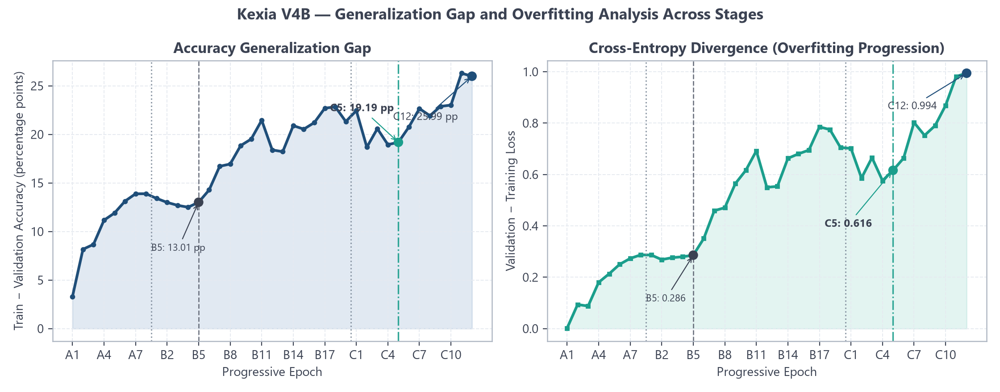
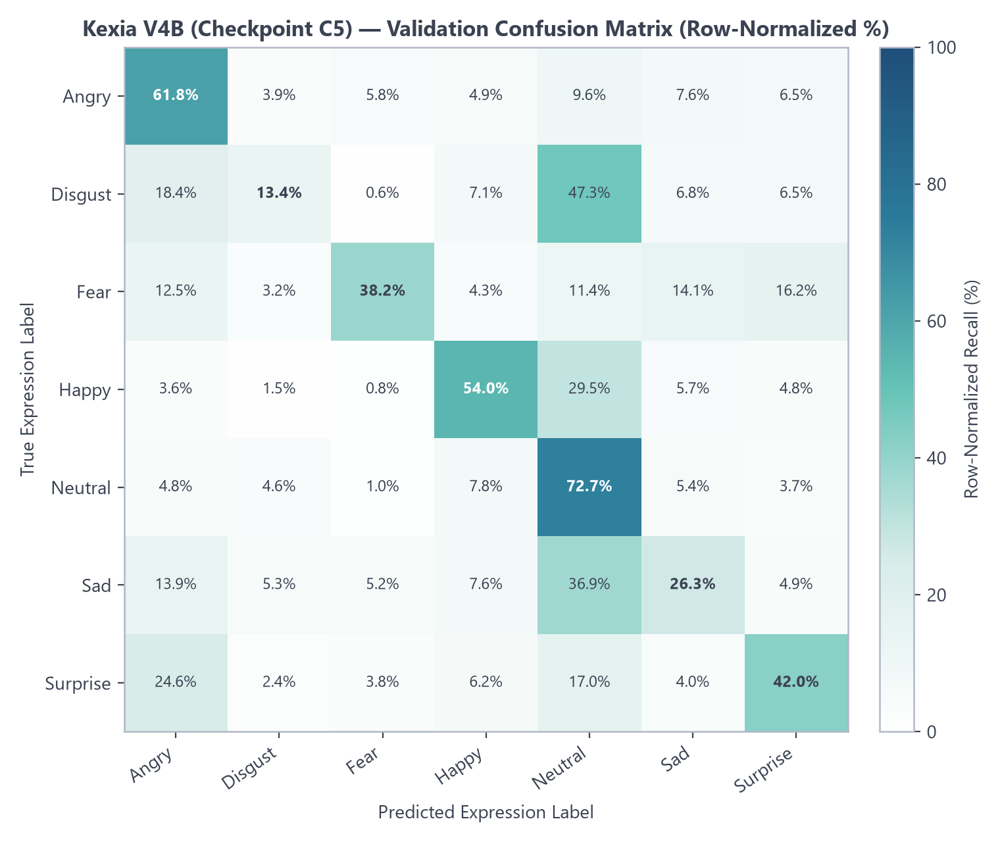
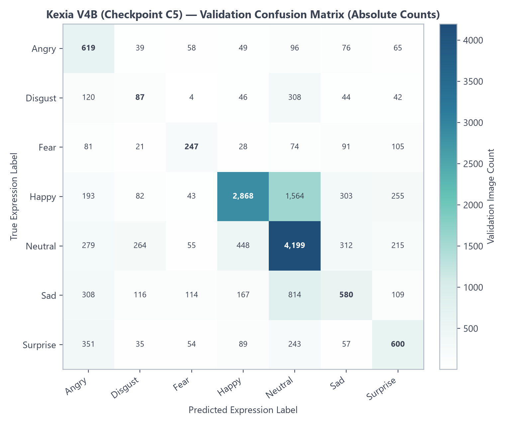

# Technical Limitations, Failure Modes, and Responsible Use — Kexia V4B

## 1. Overfitting and Generalization Gap

Progressive unfreezing of backbone layers in Stages B and C increased model capacity from `1.71M` trainable parameters (Stage A) to `17.55M` (Stage B) and `32.13M` (Stage C). While validation Macro F1 improved from `35.95%` (A8) to `40.68%` (B5) and `42.56%` (C5), the divergence between training and validation metrics demonstrates clear overfitting:

| Checkpoint / Stage-Epoch | Train Accuracy | Val Accuracy | Accuracy Gap ($\text{Train} - \text{Val}$) | Train Loss | Val Loss | Loss Divergence ($\text{Val} - \text{Train}$) | Val Macro F1 |
|---|---:|---:|---:|---:|---:|---:|---:|
| **A8** (End of Stage A) | 62.08% | 48.19% | +13.89 pp | `1.1318` | `1.4189` | `+0.2871` | 35.95% |
| **B5** (`best_original.pt`) | 66.25% | 53.24% | +13.01 pp | `1.0249` | `1.3109` | `+0.2860` | 40.68% |
| **B13** (Best of Stage B) | 71.76% | 53.53% | +18.22 pp | `0.8473` | `1.4010` | `+0.5537` | 41.39% |
| **C5** (`best.pt`, Selected) | 73.25% | **54.06%** | **+19.19 pp** | `0.7947` | `1.4110` | `+0.6163` | **42.56%** |
| **C12** (`last.pt`, Early Stop) | **77.34%** | 51.35% | **+25.99 pp** | `0.6613` | `1.6556` | `+0.9943` | 41.75% |

Between C5 and C12, training cross-entropy dropped from `0.7947` to `0.6613` while validation cross-entropy rose from `1.4110` to `1.6556`, confirming memorization of training examples during deep fine-tuning.

---

## 2. Class Imbalance and Inter-Class Confusion Analysis

Despite square-root inverse frequency weighting in the training loss ($w_{\mathrm{disgust}} = 2.380$ vs. $w_{\mathrm{happy}} = 0.740$), the validation confusion matrix at C5 reveals strong attraction toward majority classes (`neutral` and `happy`) and high confusion among negative-valence expressions:

Key failure patterns from `validation_confusion_matrix.csv` ($N = 17,017$):
1. **`disgust` Collapse (F1 = 13.44%, Support = 651):** Only `87` validation samples (13.36%) are correctly classified. Nearly half (`308` samples, **47.31%**) are misclassified as `neutral`, and `120` samples (**18.43%**) are misclassified as `angry`. Conversely, `264` true `neutral` images and `116` true `sad` images are falsely predicted as `disgust` (precision = 13.51%).
2. **`sad` Under-Recall (F1 = 31.60%, Support = 2,208):** Only `580` samples (26.27%) are recalled as `sad`. A larger fraction (`814` samples, **36.87%**) is absorbed by `neutral`, and `308` samples (**13.95%**) are predicted as `angry`.
3. **`angry` Over-Prediction (Precision = 31.73%, Recall = 61.78%):** While `angry` achieves 61.78% recall (`619 / 1,002`), the classifier predicts `angry` for `1,951` validation images in total—absorbing `351` `surprise` images (24.56% of `surprise`), `308` `sad` images, `279` `neutral` images, and `193` `happy` images.
4. **`happy` to `neutral` Drift:** Although `happy` has high precision (77.62%), its recall is 54.03% (`2,868 / 5,308`), with `1,564` true `happy` images (**29.46%**) classified as `neutral`, reflecting subtle or low-intensity smiles in heterogeneous datasets.

---

## 3. Dataset Integrity and Methodological Constraints

1. **Unresolved Perceptual Duplicates (4,865 Candidates):** Exact decoded pixel deduplication (`pixel_hash`) does not remove re-encoded, slightly cropped, or brightness-shifted copies. The audit identified 4,865 images across partitions sharing identical 64-bit `dhash` signatures (`1,750` in `train`, `1,069` in `validation`, `2,046` in `test`).
2. **Absence of Identity-Level Splitting:** Because subject identifiers are absent in the unified folder hierarchy, images of the same individual can appear across `train`, `validation`, and `test`. Optimistic leakage from shared identities cannot be ruled out.
3. **Approximate Optimizer Resumption at B5:** Resuming Stage B at epoch B6 without the saved AdamW first and second moment buffers ($m_t, v_t$) introduced a transient optimization shock before Stage C fine-tuning.
4. **Pending Ablation Baselines:** The current results establish performance for `HybridFER(mode='hybrid', fusion='gated')` (`val_macro_f1 = 42.56%`), but single-backbone (`mode='cnn'`, `mode='vit'`) and static concatenation (`fusion='concat'`) baselines have not yet been trained on the exact same manifest (`20261124_102050_038611/manifest.csv`). Therefore, superior performance of gated fusion over individual backbones is not yet empirically demonstrated.
5. **Pending Independent Test Evaluation:** The 24,090-image test set remains unevaluated for checkpoint C5; all reported metrics correspond strictly to the 17,017-image validation partition.

---

## 4. Ethical, Scientific, and Operational Boundaries

- **Visual Appearance vs. Internal Emotion:** Human facial movements are context-dependent, culturally variable, and only weakly correlated with internal affective states. A softmax score for `angry` or `sad` indicates statistical similarity to labeled facial crops in the training corpus, **not** an individual's emotional experience.
- **No Probability Calibration:** Raw softmax probabilities from deep neural networks with weighted cross-entropy are systematically miscalibrated and must not be interpreted as confidence percentages.
- **Dependency on External Face Cropping:** The model has no face detection, bounding-box regression, or keypoint alignment module. Passing uncropped scenes or poorly framed faces degrades representations unpredictably.
