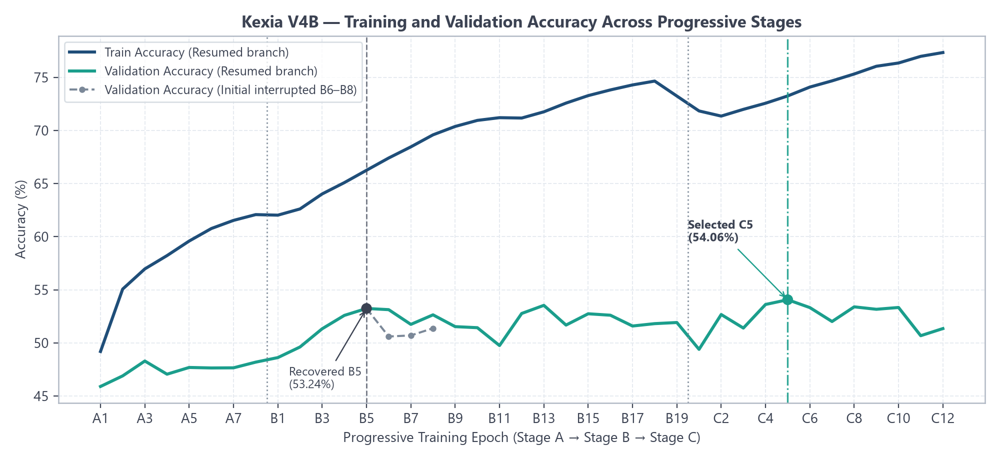
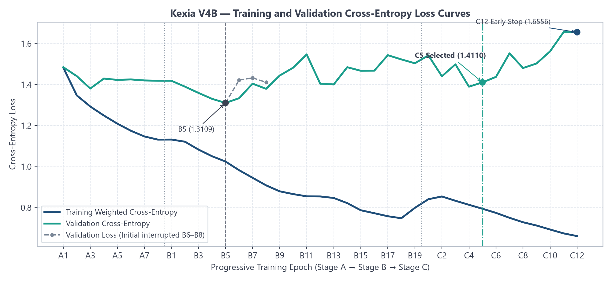
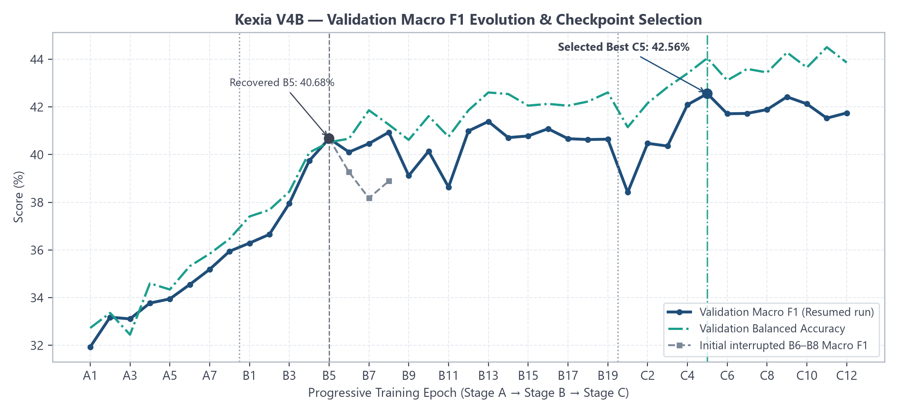

# Experimental Methodology — Kexia Facial Expression V4B

## 1. Data Preparation and Cryptographic Integrity Audit

### 1.1 Label Canonicalization
Directory names across partitions (`train`, `valid`/`validation`, `test`) are normalized via Unicode NFKD case-folding and mapped to the canonical seven-class index order:

| Index | Canonical Label | Accepted Directory Aliases (Normalized) |
|---:|---|---|
| `0` | `angry` | `anger`, `angry`, `enojo`, `ira` |
| `1` | `disgust` | `disgust`, `disgusted`, `asco`, `disgusto` |
| `2` | `fear` | `fear`, `fearful`, `miedo` |
| `3` | `happy` | `happy`, `happiness`, `felicidad`, `alegria` |
| `4` | `neutral` | `neutral`, `neutrality`, `neutro` |
| `5` | `sad` | `sad`, `sadness`, `tristeza` |
| `6` | `surprise` | `surprise`, `surprised`, `sorpresa` |

### 1.2 Three-Level Deduplication and Leakage Prevention
1. **Decoding & EXIF Orientation:** Every file is opened with Pillow, oriented via `ImageOps.exif_transpose`, and converted to `RGB`. All `163,567` candidate files decoded without error (`scan_issues.csv` contains 0 errors).
2. **Conflicting-Label Elimination:** Images are hashed by their decoded RGB array shape and byte buffer (`pixel_hash`). Any `pixel_hash` appearing with more than one class label (`158` conflicting hashes) is completely excluded from all partitions.
3. **Cross-Split Priority Retention:** Exact pixel duplicates (`1,556` cross-split pixel hashes) are deduplicated using priority $\texttt{test} (0) < \texttt{validation} (1) < \texttt{train} (2)$, preventing any identical decoded pixel array from appearing in both training and evaluation sets. In total, `7,172` files were excluded, leaving **156,395** unique-pixel images (`115,288` train, `17,017` validation, `24,090` test).
4. **Perceptual dHash Audit:** A 64-bit horizontal difference hash (`dhash`) flagged **4,865** cross-partition candidate images sharing identical coarse $9 \times 8$ luminance gradients for subsequent manual/perceptual audit.

---

## 2. Preprocessing and Augmentation Pipeline

- **Training Augmentation (`train` split only):**
  - `RandomHorizontalFlip(p=0.5)`
  - `RandomAffine(degrees=12, translate=(0.05, 0.05), scale=(0.92, 1.08))`
  - `ColorJitter(brightness=0.15, contrast=0.15, saturation=0.08)`
- **Dual-Branch Deterministic Transform (All splits):**
  - CNN branch: `Resize((160, 160), antialias=True)` $\to$ `ToTensor()` $\to$ `Normalize(mean=(0.485, 0.456, 0.406), std=(0.229, 0.224, 0.225))`
  - ViT branch: `Resize((224, 224), antialias=True)` $\to$ `ToTensor()` $\to$ `Normalize(mean=(0.485, 0.456, 0.406), std=(0.229, 0.224, 0.225))`

---

## 3. Class-Weighted Loss Function

To mitigate the imbalance between majority classes (`happy`: 34,168; `neutral`: 33,147) and minority classes (`disgust`: 3,301; `fear`: 8,325), the training criterion uses square-root inverse class frequency weights normalized so that their sample-weighted average equals 1:

$$
\tilde{w}_k = \sqrt{\frac{N_{\mathrm{train}}}{7 \, N_{\mathrm{train}, k}}}, \qquad
w_k = \frac{\tilde{w}_k}{\frac{1}{N_{\mathrm{train}}}\sum_{j=1}^{7} N_{\mathrm{train}, j}\,\tilde{w}_j}
$$

$$
\mathcal{L}_{\mathrm{train}}(\hat{\ell}, y) = - w_y \log \frac{\exp(\hat{\ell}_y)}{\sum_{j=1}^{7} \exp(\hat{\ell}_j)}
$$

This yields $w = (1.364, 2.380, 1.499, 0.740, 0.751, 1.061, 1.390)$. Validation loss is computed as standard unweighted cross-entropy to reflect true corpus log-likelihood.

---

## 4. Progressive Three-Stage Fine-Tuning Schedule

Training uses `AdamW` ($\lambda = 0.01$), gradient accumulation ($B=8$, $\text{ACCUM}=4 \implies B_{\mathrm{eff}}=32$, $3,603$ optimizer steps per epoch), global L2 gradient clipping at `1.0`, and mixed precision on an NVIDIA GeForce RTX 5070 Ti Laptop GPU.

For each stage with $T$ total optimizer steps and warmup steps $W = \max(1, \lfloor 0.05 T \rfloor)$, the learning rate multiplier at step $s \ge 0$ follows:

$$
\alpha(s) = \begin{cases}
\min\!\left(1, \dfrac{s+1}{W}\right), & s < W \\[8pt]
0.05 + \dfrac{0.95}{2}\left(1 + \cos\!\left(\pi \min\!\left(1, \dfrac{s - W}{\max(1, T - W)}\right)\right)\right), & s \ge W
\end{cases}
$$

- **Stage A (Epochs A1–A8):** Backbones frozen (`cnn` and `vit` in `eval()` mode); only `pc`, `pv`, `gate`, and `head` trained at $\text{lr}_{\mathrm{head}} = 10^{-3}$. Validation Macro F1 progressed from `0.3193` (A1) to `0.3595` (A8).
- **Stage B (Epochs B1–B19):** Unfroze the last 4 MobileNetV2 blocks ($\text{lr}_{\mathrm{cnn}} = 3 \times 10^{-5}$) and last 2 ViT encoder layers plus `encoder.ln` ($\text{lr}_{\mathrm{vit}} = 10^{-5}$), with $\text{lr}_{\mathrm{head}} = 10^{-4}$. `BatchNorm2d` layers remained frozen in `eval()` mode.
- **Stage C (Epochs C1–C12):** Unfroze the last 8 MobileNetV2 blocks ($\text{lr}_{\mathrm{cnn}} = 10^{-5}$) and last 4 ViT encoder layers plus `encoder.ln` ($\text{lr}_{\mathrm{vit}} = 5 \times 10^{-6}$), with $\text{lr}_{\mathrm{head}} = 5 \times 10^{-5}$. Stopped via early stopping at C12 (patience 7 after C5 peak).

---

## 5. Resumption Protocol and Checkpoint Selection

### 5.1 Interrupted Initial Run vs. Resumed Continuation
During the initial run (`artifacts/metrics/metrics_history.csv`), training completed Stage A (A1–A8) and Stage B up to epoch B8 (`val_macro_f1 = 0.3889`), where execution stopped. Because the initial training loop only persisted `best.pt` whenever `val_macro_f1` improved, the saved checkpoint on disk corresponded to **Stage B, Epoch 5** (`val_macro_f1 = 0.4068`, `val_accuracy = 0.5324`, `val_loss = 1.3109`) and did not store optimizer moments.

Before resuming:
1. The original B5 checkpoint was backed up intact as `best_original.pt`.
2. Training resumed from B5 at epoch B6 (`artifacts/metrics/metrics_resumed.csv`) with a newly initialized `AdamW` optimizer and the cosine learning-rate scheduler advanced to $s_0 = 5 \times 3,603 = 18,015$ completed steps.
3. Atomic checkpointing (`save_checkpoint` via `.tmp` rename) was introduced to save `last.pt` after every epoch with full `optimizer`, `scheduler`, and `scaler` state dictionaries alongside `best.pt`.

### 5.2 Selection by Validation Macro F1
Checkpoints are selected strictly by **Validation Macro F1**:

$$
F_{1,\mathrm{macro}} = \frac{1}{7}\sum_{k=1}^{7} \frac{2 P_k R_k}{P_k + R_k}
$$

As shown below, Macro F1 peaked at **Stage C, Epoch 5 (`C5`)** with **42.56%** (`0.425577`), improving by **+1.88 percentage points** over the recovered B5 checkpoint (`40.68%`) and outperforming the final early-stopped epoch C12 (`41.75%`).

